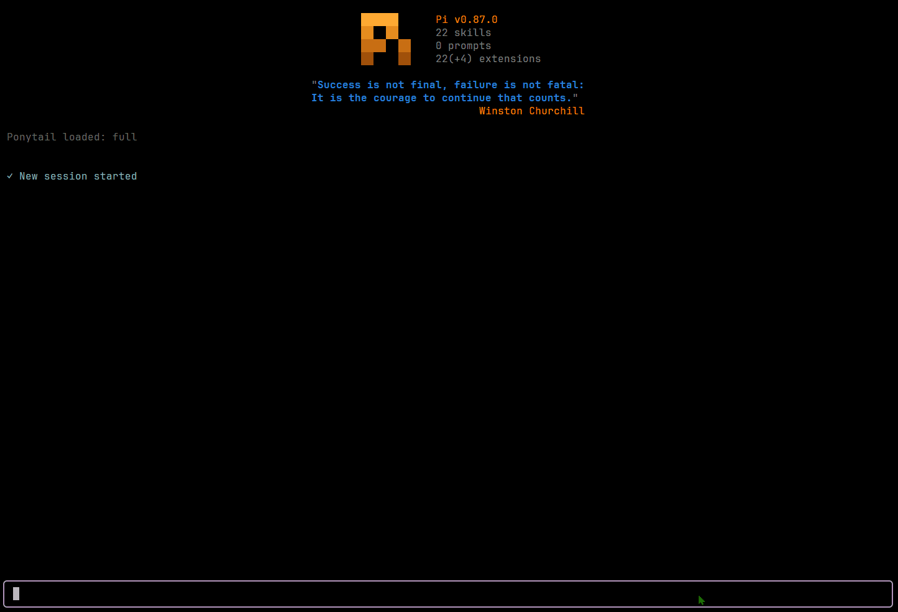

<p align="center">
  
</p>

# pi-prompton

Prompt-rewriting extension for [Pi](https://github.com/earendil-works/pi-mono). Takes a rough draft in the Pi editor and turns it into a cleaner, stronger prompt without leaving the editor.

<p align="center">
  
</p>

> **Fork of [ayagmar/pi-promptsmith](https://github.com/ayagmar/pi-promptsmith)** — original work by [@ayagmar](https://github.com/ayagmar). This fork is maintained separately and may diverge.

Two output styles:

- **Plain rewrite** — tighten and clarify the prompt
- **Execution contract** — turn a rough task into a compact, agent-executable spec

## Comparison: pi-promptsmith vs pi-prompton

`pi-prompton` is an enhanced fork of [`ayagmar/pi-promptsmith`](https://github.com/ayagmar/pi-promptsmith). Below is a comparison of key features, architecture, and capabilities:

| Feature / Aspect           | `pi-promptsmith` (Upstream)             | `pi-prompton` (This Fork)                                                                    |
| -------------------------- | --------------------------------------- | -------------------------------------------------------------------------------------------- |
| **Package Name**           | `pi-promptsmith`                        | `pi-prompton`                                                                                |
| **Command Prefix**         | `/promptsmith`                          | `/prompton`                                                                                  |
| **Settings File**          | `~/.pi/agent/promptsmith-settings.json` | `~/.pi/agent/prompton-settings.json` (auto-migrates legacy settings)                         |
| **LLM Prompt Strategy**    | Dual-strategy (`gpt.ts` & `claude.ts`)  | Unified strategy (`unified.ts`) with target-family awareness                                 |
| **Prompt Coaching Suite**  | None                                    | `/prompton lint`, `score`, `coach`, `clarify`, `template`, `history` + `auto-clarify` toggle |
| **Clarify Mode**           | None                                    | Single-dialog lint + intent clarification before enhancement                                 |
| **Prompt Linting**         | None                                    | Local instant linting (`/prompton lint`) for missing verbs, scope, subjects                  |
| **Prompt Quality Scoring** | None                                    | LLM-based 1–5 score with top 3 weaknesses (`/prompton score`)                                |
| **Inline Annotations**     | None                                    | `[category: suggestion]` annotations without rewriting (`/prompton coach`)                   |
| **Starter Templates**      | None                                    | 4 intent-based skeletons (`/prompton template`)                                              |
| **Empty Editor Action**    | Opens settings dialog                   | Opens template picker dialog (both command & shortcut)                                       |
| **Draft History / Undo**   | Single-entry undo (`/promptsmith undo`) | Opt-in, session-only 10-entry history (`/prompton history`) + `/prompton undo`               |
| **Token Estimation**       | None                                    | Token estimate (`~N tokens`) in enhancement notifications                                    |
| **CLI Auto-Completions**   | Subcommands only                        | Subcommands + value completions (`auto-clarify on/off`, `family auto/gpt/claude`, etc.)      |
| **Settings Migration**     | N/A                                     | Backward-compatible fallback for legacy `promptsmith-settings.json`                          |

## Installation

> Requires Pi 1.x (tested with Pi 1.3.0).

Run once without installing:

```bash
pi -e npm:pi-prompton
```

Install as a Pi package:

```bash
pi install npm:pi-prompton
```

Install from git:

```bash
pi install git:github.com/the-matt-moo/pi-prompton
```

## Quick start

### Enhance the current editor draft

1. Type a rough prompt in the Pi editor.
2. Press **`Alt+P`** or run `/prompton` as a slash command.
3. Review the rewritten prompt, then submit it normally.

When the editor is empty, `/prompton` and `Alt+P` open the template picker instead. Choose a template, fill in its `[brackets]`, then enhance again. Choose `/prompton input` when you want a blank editor instead of a template.

### Enhance or inspect a one-off prompt

Pass the draft in matching double quotes, single quotes, or backticks:

```text
/prompton "rough prompt"           # enhance
/prompton lint "rough prompt"      # lint locally
/prompton coach 'rough prompt'     # add inline coaching
/prompton score `rough prompt`     # score quality
/prompton clarify "rough prompt"   # append a clarification
```

Quoted input becomes the current editor draft. Run these through Pi's slash-command interface; text merely pasted into the editor is prompt content, not an executed command.

### Undo and history

Prompt history is off by default. Run `/prompton history on` to enable the shared session-only buffer used by both commands.

- `/prompton undo` restores the draft from before the last editor-changing action when history is enabled.
- `/prompton history` restores one of the last 10 drafts changed in the current Pi session when history is enabled.
- `/prompton history off` disables tracking and clears buffered drafts.
- Pi's normal `Ctrl+Z` editor undo and Pi's own session logging are unaffected.

## Rewrite modes

Configured in `~/.pi/agent/prompton-settings.json`.

### `auto` (default)

Uses TypeSafe Jev Choice to classify the draft when the shared `pi-bifrost/jev-api-key` Windows Credential Manager entry is available, then picks the output style. It falls back to local heuristics when Jev is unavailable or uncertain. It chooses **execution-contract** for coding tasks (implement, debug, refactor, review, research, docs, tests), and **plain** for explanations, brainstorming, prose cleanup, and open-ended chat.

### `plain`

Always produce a stronger prompt — no execution contract structure.

### `execution-contract`

Always produce a compact task spec. Includes what is useful from: goal, context, constraints, files to inspect, expected change, verification steps, output expectations. Not a fixed template — keeps concrete user details, avoids invented requirements.

## Unified prompt strategy

Prior versions maintained separate GPT and Claude prompt-construction paths. In v0.5.0 these were collapsed into a single unified strategy, co-designed through a Claude (Anthropic) and ChatGPT (OpenAI gpt-5.6-sol) review cycle:

1. **Claude** drafted the unified prompt and implementation.
2. **gpt-5.6-sol** reviewed for regressions, identified five issues (underspecified target-family semantics, dropped guidance lines, conflicting XML rules, implicit setting behavior, and missing test coverage).
3. Both models converged on the final prompt and code.

The result:

- One request builder (`strategies/unified.ts`) replaces the former `strategies/gpt.ts` and `strategies/claude.ts`.
- The best GPT-specific guidance (outcome-first structure, decision rules over step stacks, evidence/tool boundaries for agentic work) was promoted to universal instructions in the shared system prompt.
- When `targetFamilyMode` is `auto` (default), `resolved_target_family` is set to `universal` and the rewrite is fully model-agnostic — no `active_model` consumer hint is sent. Explicit `gpt` or `claude` modes still produce family-targeted output.
- Enhancer model selection is independent of the output target: `family-linked` mode still resolves the active model's family to pick the right enhancer even when the output is universal.
- `rewrite_strength` and `preserve_code_blocks` now have explicit behavioral semantics in the system prompt rather than relying on implicit interpretation.
- XML-like sections are governed by one consistent rule: use them only when the draft already does or when they materially improve reliable execution or parsing.

## Examples

### Plain rewrite

Input:

```
can you rewrite this prompt so it sounds better and asks for a short explanation of how model routing works
```

Output:

```
Explain how Prompton model routing works. Keep the explanation concise and practical. Focus on how the active model, explicit overrides, and fallback rules determine the final target family.
```

### Execution contract

Input:

```
add rewrite mode support for prompton and make status show what mode it picks
```

Output:

```
Goal
Add rewrite mode support to Prompton and update status reporting so it shows both the configured mode and the resolved mode for the current editor draft.

Constraints
- Preserve current preview, undo, timeout, and cancellation behavior.
- Keep settings persisted globally across Pi sessions.
- Do not add extra model calls.

What to inspect
- command handling and persisted settings
- enhancement request shaping
- status reporting
- settings UI

Verification
- update or add tests for mode persistence, command handling, and status output
- run the relevant project checks
```

## Prompt coaching tools

Prompton includes optional tools beyond the core rewriter. When prompt history is enabled, editor-changing actions save the previous draft for `/prompton undo`.

### Lint

Local, instant, no LLM call. Flags structural weaknesses before enhancement: missing verbs, vague subjects, unbounded scope, bare questions, drafts that are too short or too long.

```
/prompton lint
/prompton lint "rough prompt"
```

### Score

LLM-based quality rating (1–5) with up to 3 concrete weaknesses. Read-only, cancellable, and governed by the configured enhancement timeout.

```
/prompton score
/prompton score "rough prompt"
```

### Coach

Inline annotations on weak spots. The model inserts `[category: suggestion]` brackets directly into your draft without rewriting it. Invalid model output fails closed and leaves the draft unchanged.

```
/prompton coach
/prompton coach "rough prompt"
```

Annotation categories: `vague`, `missing-context`, `unbounded`, `no-verification`, `missing-constraint`, `ambiguous`.

### Clarify

A single dialog shown only when local lint finds missing information. Choose an intent-aware suggestion or **Type something** to add your own clarification.

```text
/prompton clarify                       clarify the current draft once
/prompton auto-clarify on|off           clarify before `/prompton` enhancement
/prompton clarify-on-shortcut on|off    clarify before shortcut enhancement
```

One-shot clarification appends the selected detail to the editor; run `/prompton` afterward to enhance it. Auto-clarify continues directly to enhancement. If local lint finds no issues, the dialog is skipped. Press `Esc` to cancel without changing the draft.

### Templates and blank input

When the editor is empty, both `/prompton` and the shortcut (`Alt+P`) open the same picker with Implement, Debug, Refactor, and Review templates.

```text
/prompton template        open the template picker
/prompton input           clear the editor for free-form input
```

If the editor already contains text, either command asks before replacing it. The old draft is saved only when prompt history is enabled. Inline drafts can be wrapped in double quotes, single quotes, or backticks for `/prompton`, `/prompton coach`, `/prompton lint`, `/prompton score`, and `/prompton clarify`.

### History

Prompt history is opt-in, in memory only, and limited to the current Pi session. When enabled, Prompton keeps the last 10 replaced drafts; browsing history also keeps the replaced editor text available to undo. Disabling history clears the buffer so drafts do not reappear when it is re-enabled. This setting does not change Pi's own session logging.

```
/prompton history on     enable prompt history and undo
/prompton history        browse and restore past drafts
/prompton history off    disable tracking and clear buffered drafts
```

### Token estimate

After every enhancement, the success notification includes an approximate token count for the enhanced prompt (e.g. `Prompton enhanced the current draft. (~85 tokens)`). No extra command needed.

## Commands

```
/prompton                    enhance current editor draft
/prompton undo               restore pre-enhancement draft
/prompton status             show configuration and runtime state
/prompton settings           open configuration modal (primary settings entry)
/prompton reset-settings     restore global defaults
/prompton lint               local prompt lint (instant, no LLM)
/prompton score              LLM-based quality rating (1-5)
/prompton coach              inline annotations on weak spots
/prompton clarify            single-step clarification dialog
/prompton auto-clarify on|off     toggle clarify before enhancement
/prompton clarify-on-shortcut on|off   toggle clarify on shortcut
/prompton template           pick a prompt skeleton
/prompton input              clear editor for free-form prompt entry
/prompton history            browse and restore past drafts when enabled
/prompton history on|off     toggle session-only prompt history and undo
/prompton help               show commands with short descriptions
```

Prefer `/prompton settings` for configuration. Existing quick-config commands remain supported:

```
/prompton enable
/prompton disable
/prompton family auto|gpt|claude
/prompton mode auto|plain|execution-contract
/prompton enhancer-model active
/prompton enhancer-model fixed <provider>/<id>
/prompton enhancer-model fallback <provider>/<id> [provider/id...]|off
/prompton enhancer-model family-linked <gpt-provider>/<gpt-id> <claude-provider>/<claude-id>
/prompton map active <gpt|claude>
/prompton map set <provider>/<id> <gpt|claude>
/prompton map add <pattern> <gpt|claude>
/prompton map remove <pattern>
/prompton conversation on|off
/prompton project-metadata on|off
/prompton status-bar on|off
/prompton strength light|balanced|strong
/prompton preview on|off
/prompton auto-send on|off
/prompton auto-send-when-busy steer|follow-up
/prompton preserve-code on|off
/prompton timeout <seconds>
```

### Interactive settings UX

- `/prompton settings` opens a centered, themed modal; changes save immediately, not on close
- `↑`/`↓` navigate and scroll (wrap at either end); type to search, `Backspace` edits search
- `Enter` toggles the selected checkbox or opens its selector; `Space` does the same when search is empty
- `Esc` (or `Ctrl+C`) and the **Done** row close; closing does not undo already saved changes
- Secondary selectors temporarily hide the modal, then restore its search and selection
- Secondary selectors retain `/` search and `PageUp`/`PageDown` paging; `Esc` cancels without saving
- Keyboard shortcut toggles inline; **Shortcut keybinding** remaps or resets to `Alt+P`
- Remapping: press new combo directly; `Esc` cancels, `Backspace` resets
- Fallback chain: add models at the end, select an entry to remove/move up/move down, or clear the chain
- Prompt history and undo remain off by default; disabling clears the session-only buffer. Without history, editor replacements cannot be undone by Prompton
- Jev scoring and intent verification are separate opt-in toggles, both off by default; they call an external service when configured
- Auto-send submits the refined prompt immediately; **Auto-send while busy** chooses `steer` or `follow-up` (used only when auto-send is on)
- The modal requires interactive TUI mode; RPC/print clients can use the existing configuration commands

## Settings

Stored at `~/.pi/agent/prompton-settings.json`. On first use after upgrading from Promptsmith, Prompton also reads the legacy `promptsmith-settings.json` file as a fallback.

Set the JSON key `historyEnabled` to `true` to opt in to prompt history and undo. Its default is `false`; omitted or invalid values resolve to `false`.

| Setting                  | Default    |
| ------------------------ | ---------- |
| keyboard shortcut        | `Alt+P`    |
| rewrite mode             | `auto`     |
| rewrite strength         | `balanced` |
| status bar               | `off`      |
| recent conversation      | `off`      |
| project metadata         | `off`      |
| preview before replace   | `false`    |
| auto-send                | `false`    |
| auto-send while busy     | `steer`    |
| preserve code blocks     | `true`     |
| enhancer fallback chain  | `off`      |
| enhancement timeout      | `45s`      |
| clarify before enhancing | `off`      |
| clarify on shortcut      | `off`      |
| prompt history and undo  | `off`      |

## Context

Always included: current editor draft, rewrite mode, target-family routing, and intent detection. Intent detection uses Jev when available and falls back to local heuristics.

Optional (off by default):

- **Recent conversation** — recent chat history from the current session branch
- **Project metadata** — working directory and git branch

Does not read repo files, `AGENTS.md`, or README by default.

## Routing

When `targetFamilyMode` is `auto` (the default), the output target is `universal` — a portable, model-agnostic rewrite with no `active_model` consumer hint. Explicit `gpt` or `claude` modes produce family-targeted output.

Enhancer model selection is independent: `family-linked` mode still resolves the active model's family using the resolution order below, even when the output target is universal.

Auto-send (`/prompton auto-send on`) is extension-originated and can bypass dynamic router classification; Prompton does not add a Bifrost protocol or impersonate remote-pi.

Family resolution order (used for enhancer routing and explicit targeting):

1. Forced family (when not `auto`)
2. Exact model overrides
3. Pattern overrides
4. Built-in defaults
5. Fallback family

Built-in defaults: OpenAI GPT/o-series → `gpt`, Anthropic Claude → `claude`, Kimi-style → `claude`.

Enhancer model modes: `active`, `fixed`, `family-linked`. Optional fallback models run in order after primary format or provider failures; each fallback is tried once.

## Safety

- Editor not mutated on failure or cancellation
- Hung requests time out; only one enhancement runs at a time
- Preview mode: review before replace
- Output must contain exactly one sentinel block; bad primary output is retried once, then configured fallback models are tried in order on format or provider failures
- Invalid output reports whether the model missed the sentinel, emitted multiple blocks, added extra text, or returned empty
- GPT calls request concise output where the provider supports verbosity controls
- Collapsed Pi paste markers recovered from clipboard where possible; multi-marker drafts fail closed
- Oversized drafts fail clearly instead of silent truncation
- Intent detection uses Jev when configured, with deterministic local fallback and no added enhancement model call
- Prompt history and undo are disabled by default; when enabled, drafts stay in a session-only in-memory buffer and are not written to the settings file. Pi's own session logging is unaffected
- `jevScoringEnabled` (default off): score command uses Jev's typed Score judgment for the 1-5 rating, falling back to the enhancer model's own parsed rating when unset, unconfigured, or unavailable
- `jevVerificationEnabled` (default off): enhanced rewrites are checked with Jev for dropped/contradicted intent before acceptance; unavailable or uncertain Jev fails open (never blocks a structurally valid rewrite). Both are opt-in since they call an external service and must not activate just because an unrelated tool's Jev credential exists on the machine

## Runtime support

| Mode            | Support                                                                                   |
| --------------- | ----------------------------------------------------------------------------------------- |
| Interactive TUI | Full                                                                                      |
| RPC             | Status and settings commands only; in-place enhancement blocked (no editor buffer access) |
| print/json      | Editor-dependent actions unsupported                                                      |

## Development

```bash
git clone https://github.com/the-matt-moo/pi-prompton.git
cd pi-prompton
pnpm install
pnpm run check
```

Load local extension in Pi:

```bash
pi -e ./src/index.ts
```
